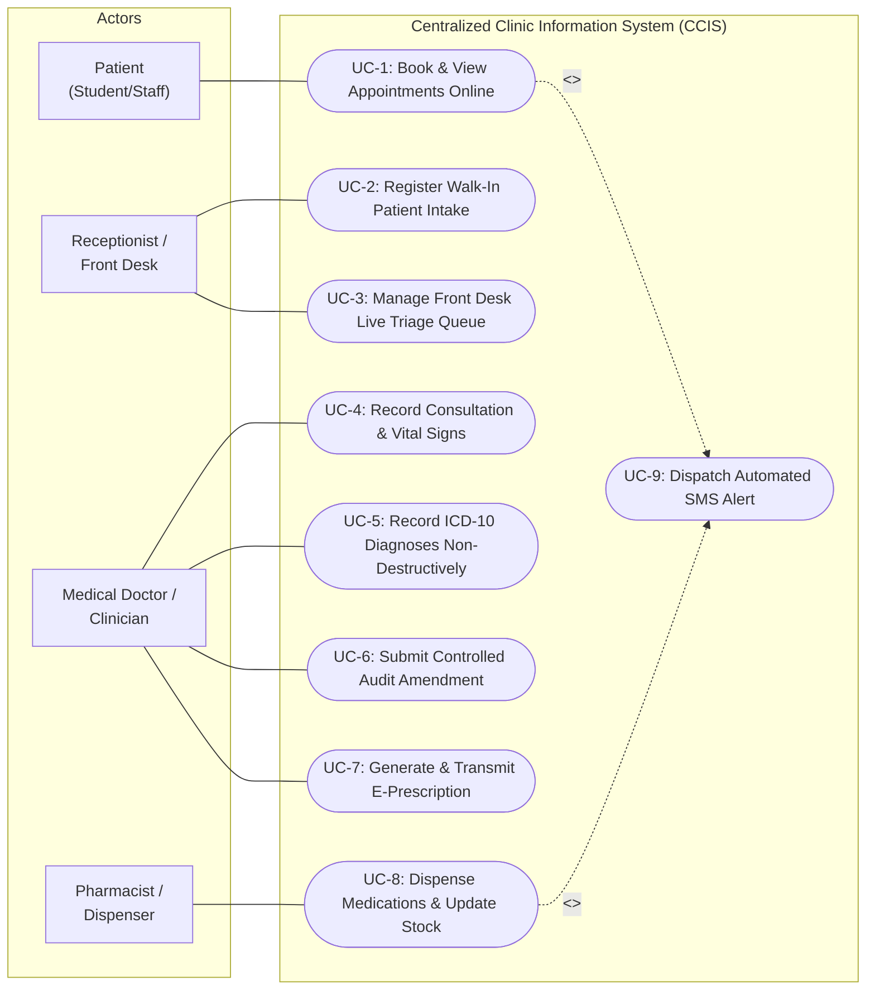
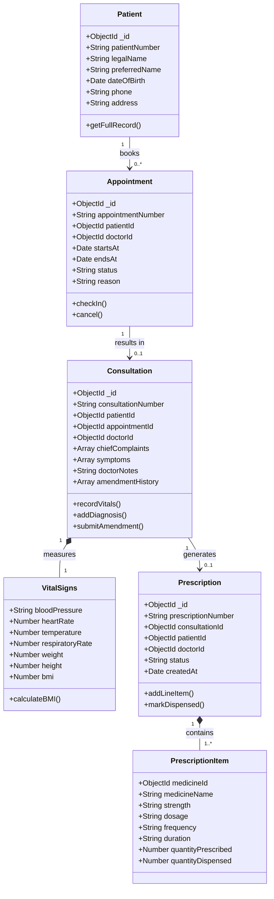
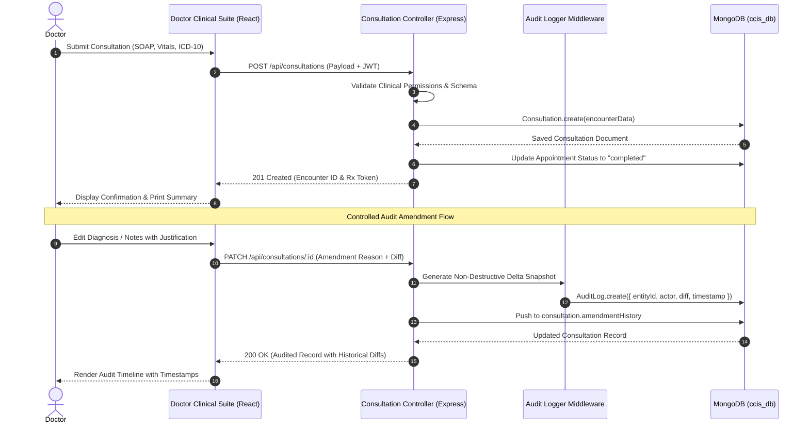
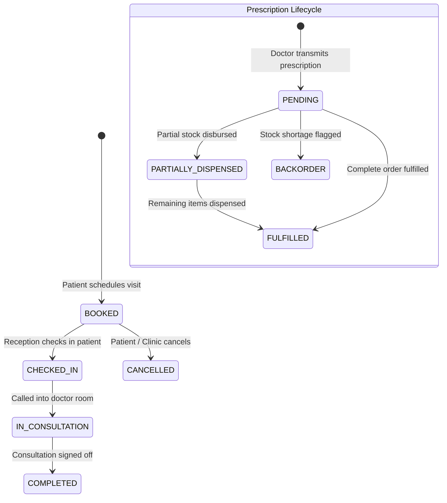

# Software Requirements Specification (SRS) & System Design Document
## Centralized Clinic Information System (CCIS)

> **Document Type:** IEEE 830-1998 Software Requirements Specification & Architectural Design Document  
> **Course:** Academic Group Project (Level 300 / Week 8 Final Submission)  
> **System Name:** Centralized Clinic Information System (CCIS)  
> **Target Problem:** University Campus Health Clinic Appointment Queueing, Medical Encounters & Pharmacy Dispensing  
> **Version:** 1.0 (Final Comprehensive Edition)  
> **Primary Deliverable Files:**
> - Microsoft Word Document: [`docs/CCIS_SRS_and_Design_Document.docx`](./CCIS_SRS_and_Design_Document.docx)
> - Printable PDF Document: [`docs/CCIS_SRS_and_Design_Document.pdf`](./CCIS_SRS_and_Design_Document.pdf)

---

## Table of Contents
1. [Introduction](#1-introduction)
2. [Overall System Description](#2-overall-system-description)
3. [Functional Requirements & Use Cases](#3-functional-requirements--use-cases)
4. [External Interface Requirements](#4-external-interface-requirements)
5. [Non-Functional Requirements](#5-non-functional-requirements)
6. [Structural & Behavioral UML Diagrams](#6-structural--behavioral-uml-diagrams)
7. [Database Schema & Data Dictionary](#7-database-schema--data-dictionary)
8. [Agile Sprint Governance & Rotating Roles](#8-agile-sprint-governance--rotating-roles)

---

## 1. Introduction

### 1.1 Purpose
This document provides the complete functional, non-functional, and architectural specification for the **Centralized Clinic Information System (CCIS)**. It serves as the primary technical specification for academic evaluators, clinical end-users, software developers, and quality assurance engineers.

### 1.2 Problem Statement & Motivation
University health clinics face persistent operational friction:
- **Excessive Waiting Room Congestion:** Patients wait in unstructured physical queues without visibility into clinician availability or estimated consultation times.
- **Fragmented Paper Folders:** Physical health records are vulnerable to misfiling, duplicate registrations, and manual handwriting illegibility.
- **Uncoordinated Prescription Handoffs:** Prescriptions handwritten by medical doctors must be manually carried to the university dispensary, frequently leading to stock-out delays and transcription errors.
- **Lack of Patient Self-Service:** Students and faculty members have no mechanism to pre-book appointments around their lecture timetables.

### 1.3 Project Scope
In compliance with the Group Project Brief requiring **3–5 core features**, a **database**, and an **external service**, CCIS delivers:
1. **Module 1 (Patient Intake & Live Queue Desk):** Fast walk-in registration, duplicate registry screening, and real-time appointment check-in queues.
2. **Module 2 (Clinical Consultation Records):** Clinician workstation for recording vital signs (with automatic BMI calculation), SOAP notes, ICD-10 diagnoses, and controlled audit amendments.
3. **Module 3 (Electronic Prescription & Dispensing):** Prescription authoring, formulary stock checks, 3-stage dispensing tracking, and collection workflows.
4. **Module 4 (Patient Portal):** Self-service appointment scheduling, time slot reservation, and contact information management.
5. **External Service (SMS Notification Gateway):** Automated SMS delivery for appointment booking confirmations, front desk check-in receipts, and pharmacy pickup alerts.

---

## 2. Overall System Description

### 2.1 Product Perspective & Three-Tier Architecture
CCIS is engineered using a modern Three-Tier Architecture:
- **Presentation Tier:** React 18 SPA styled with Tailwind CSS, strictly observing an executive 3-color clinical design system (Teal `#0d9488`, Slate `#0f172a`, White `#ffffff`) with zero emojis or icons for high visual clarity and responsiveness across mobile, tablet, and desktop viewports.
- **Application & Business Tier:** Node.js and Express.js REST API providing Role-Based Access Control (RBAC), JSON Web Token (JWT) verification, validation middleware, and an immutable audit logger.
- **Database & External Tier:** MongoDB (via Mongoose ODM) for persistent storage and an external SMS Gateway API (Twilio / Sandboxed Mobile Service).

```mermaid
flowchart TD
    subgraph Presentation_Tier ["Client Presentation Tier (React 18 & Tailwind CSS)"]
        UI1["Doctor Clinical Suite\n(Consultation, SOAP, Vitals)"]
        UI2["Reception Desk\n(Walk-in Intake, Live Queue)"]
        UI3["Pharmacy & Dispensing\n(Catalog, Dispensing Tracker)"]
        UI4["Patient Portal\n(Self-Service Booking)"]
    end

    subgraph Application_Tier ["Application & Security Tier (Node.js & Express.js)"]
        AUTH["Auth & RBAC Middleware\n(JWT & Role Guards)"]
        API1["/api/appointments\n(Queue & Schedule)"]
        API2["/api/consultations\n(SOAP & Audit Logs)"]
        API3["/api/prescriptions\n(Handoff & Dispensing)"]
        EXT_SVC["/api/notifications\n(External SMS Gateway)"]
    end

    subgraph Data_Tier ["Persistent Database Tier (MongoDB & Mongoose)"]
        DB[(ccis_db\npatients | appointments\nconsultations | medical_records\nprescriptions | audit_logs)]
    end

    subgraph External_Service ["External 3rd-Party Service"]
        SMS["SMS Gateway Sandbox\n(Twilio / Mobile Telco Gateway)"]
    end

    Presentation_Tier <-->|HTTPS / REST| Application_Tier
    Application_Tier <-->|Mongoose ODM| Data_Tier
    EXT_SVC <-->|REST API Call| SMS
```

---

## 3. Functional Requirements & Use Cases

### 3.1 Actor Specifications
- **Patient (Student / University Staff):** Views specialist doctors, schedules appointments online, and receives SMS reminders.
- **Receptionist / Front Desk Officer:** Checks in scheduled arrivals, registers walk-in patients, and monitors live queue stages.
- **Medical Doctor / Clinician:** Evaluates patients, records vital signs and diagnoses, conducts consultations, and creates electronic prescriptions.
- **Pharmacist / Dispenser:** Inspects incoming doctor prescriptions, validates medication stock levels, and dispenses drugs.
- **System Administrator:** Manages clinical user accounts and audits system activity logs.



---

## 4. Structural & Behavioral UML Diagrams

### 4.1 Domain Class Diagram


### 4.2 Sequence Diagram: Clinical Consultation & Audit Amendment


### 4.3 State Machine Diagram


---

## 5. Non-Functional Requirements (NFR)

1. **Performance & Throughput:**
   - Database queries on indexed fields (`patientNumber`, `appointmentNumber`, `prescriptionNumber`) must resolve within 50ms.
   - API endpoints must deliver responses within 200ms at peak morning registration hours (8:00 AM – 11:00 AM).
2. **Security & Data Privacy:**
   - Passwords hashed using `bcryptjs` with 10 salt rounds.
   - All protected routes verified through JWT bearer tokens carrying role claims (`doctor`, `receptionist`, `pharmacist`, `patient`).
   - No consultation record may be hard-deleted from the database; edits are recorded via audit delta logs.
3. **Clinical User Experience:**
   - Strict 3-color palette (Teal, Slate, White) to prevent visual fatigue in high-stress clinic environments.
   - Fully responsive layouts supporting low-cost reception desk terminals, clinical tablets, and student smartphones.

---

## 6. Database Schema & Data Dictionary

| Collection | Key Attributes | Types & Constraints | Purpose |
| :--- | :--- | :--- | :--- |
| **`patients`** | `_id`, `patientNumber`, `legalName`, `preferredName`, `dateOfBirth`, `phone`, `address` | `ObjectId`, `String (Indexed)`, `Date` | Central patient identity directory |
| **`appointments`** | `_id`, `appointmentNumber`, `patientId`, `doctorId`, `startsAt`, `endsAt`, `status` | `ObjectId`, `String`, `Date`, `Enum` | Daily schedule and queue states |
| **`consultations`** | `_id`, `consultationNumber`, `patientId`, `doctorId`, `vitalSigns`, `chiefComplaints`, `amendmentHistory` | `ObjectId`, `String`, `SubDocument`, `Array` | Clinical encounter documentation |
| **`prescriptions`** | `_id`, `prescriptionNumber`, `consultationId`, `patientId`, `doctorId`, `items`, `status` | `ObjectId`, `String`, `Array<Item>`, `Enum` | Electronic pharmacy orders |
| **`audit_logs`** | `_id`, `entityId`, `entityType`, `performedBy`, `action`, `deltaSnapshot`, `timestamp` | `ObjectId`, `String`, `Object`, `Date` | Immutable medical data audit trail |

---

## 7. Agile Sprint Governance & Rotating Roles

In accordance with the Academic Group Project Brief, the team operated on a 3-week role rotation schedule across the 8-week project:

| Role | Sprint 1 (Weeks 1–3)<br/>*Foundation & Patient Intake* | Sprint 2 (Weeks 4–6)<br/>*Clinical Core & Prescriptions* | Sprint 3 (Weeks 7–8)<br/>*Integration, Testing & Final Delivery* |
| :--- | :--- | :--- | :--- |
| **Project Manager** | **Vincent Amoakohene**<br/>Sprint backlog, Git branch strategy, team setup | **Kuugbepuo Ametus**<br/>Sprint reviews, cross-module integration velocity | **5240101431-SL**<br/>Risk management, final Week 8 submission audit |
| **Lead Developer** | **Kuugbepuo Ametus**<br/>MERN project scaffold, MongoDB schemas | **Vincent Amoakohene**<br/>Consultation module, audit amendments, Rx handoff | **Vince2456**<br/>External SMS integration & 3-color UI system |
| **Testing Engineer** | **5240101431-SL**<br/>Jest test harness setup, unit test coverage | **Vince2456**<br/>RBAC access control tests, API integration tests | **Vincent Amoakohene**<br/>Automated regression suite & UI responsiveness |
| **Documentation Lead** | **Vince2456**<br/>API documentation, Postman collection | **5240101431-SL**<br/>IEEE SRS draft, UML behavioral diagrams | **Kuugbepuo Ametus**<br/>Final Word/PDF packaging, demo script & reflections |

---

## 8. Verification & Access to Generated Deliverables

The formal Word and PDF editions containing all rendered diagrams, tables, and formatting have been placed in the repository's `docs/` directory:
- [CCIS_SRS_and_Design_Document.docx](file:///C:/Users/RICH/Desktop/CCIS/centralized-clinic-information-system/docs/CCIS_SRS_and_Design_Document.docx) (1.73 MB, fully styled Microsoft Word document with cover page)
- [CCIS_SRS_and_Design_Document.pdf](file:///C:/Users/RICH/Desktop/CCIS/centralized-clinic-information-system/docs/CCIS_SRS_and_Design_Document.pdf) (2.05 MB, publication-ready PDF with running headers and page numbers)
